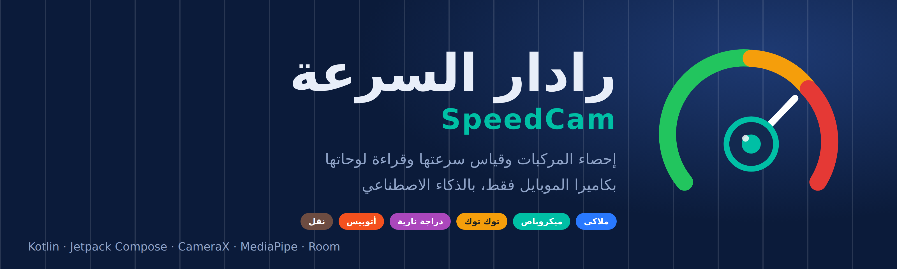
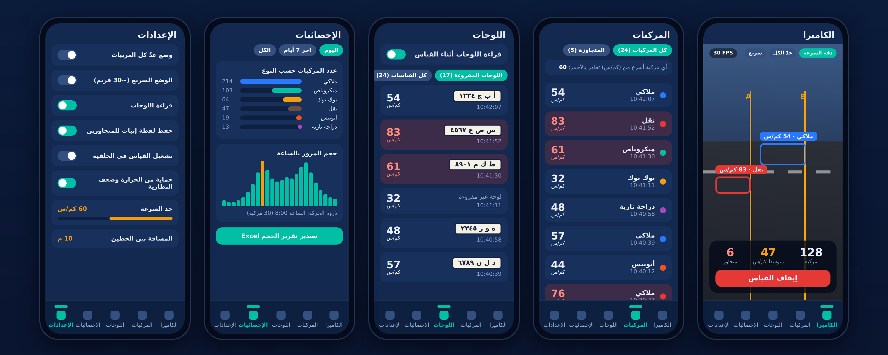
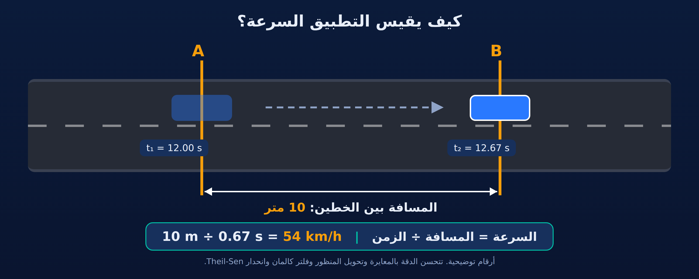
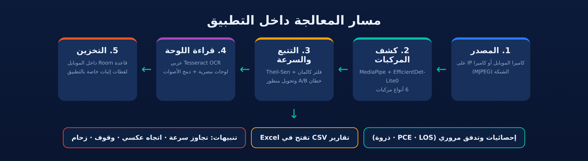

<p align="center">
  
</p>

<p align="center">
  <a href="README.en.md"><b>English</b></a> · <b>العربية</b>
</p>

<p align="center">
  
  
  
  
</p>

<div dir="rtl" align="right">

# رادار السرعة (SpeedCam)

**تطبيق أندرويد يحوّل الموبايل إلى محطة إحصاء مروري**: يكشف المركبات بالذكاء الاصطناعي، يصنّفها (ملاكي، ميكروباص، توك توك، نقل، أتوبيس، دراجة نارية)، يقيس سرعة كل مركبة، يقرأ لوحتها، ويطلّع تقارير جاهزة للمهندسين. كل المعالجة تتم على الموبايل نفسه، من غير خادم ومن غير أجهزة رادار.

## لمحة سريعة

| | |
|---|---|
| **القياس** | سرعة كل مركبة بين خطين A و B تحددهما على الصورة |
| **التصنيف** | 6 أنواع مركبات، بتشمل الميكروباص والتوك توك |
| **اللوحات** | قراءة اللوحات المصرية وتسجيلها مع سرعة المركبة |
| **التقارير** | إحصائيات وحجم مرور بالساعة واليوم، وتصدير CSV يفتح في Excel |
| **الإثبات** | لقطة لكل مركبة تتجاوز حد السرعة الذي تحدده |
| **التشغيل** | كاميرا الموبايل أو كاميرا IP على الشبكة |

## الشاشات

<p align="center">
  
</p>

> الصورة أعلاه **رسم توضيحي** لشاشات التطبيق الخمس (الكاميرا، المركبات، اللوحات، الإحصائيات، الإعدادات) بأرقام تجريبية، وليست لقطات شاشة حقيقية.

## المميزات

### القياس والكشف
- **ثلاثة أوضاع تشغيل** تبدّل بينها في أي وقت:
  - **دقة السرعة:** الوضع الأساسي لقياس السرعة بدقة.
  - **عدّ كل المركبات:** عدّ أي مركبة تعدّي أي خط من غير التركيز على السرعة.
  - **السريع:** مراقبة الحركة عند الخطين بحوالي 30 إطار/ث، والموديل للتصنيف فقط.
- **تصنيف 6 أنواع** بموديل EfficientDet-Lite0، مع تمييز الميكروباص والتوك توك بحجم المركبة (حدود قابلة للتعديل).
- **كاميرا IP على الشبكة** (بث MJPEG عبر HTTP) كبديل لكاميرا الموبايل.

### دقة القياس
- **معايرة السرعة** بعينات حقيقية (انحدار خطي) مع عرض هامش الخطأ.
- **معايرة تلقائية بالـ GPS:** موبايل ثانٍ داخل مركبة مرجع يسجل سرعتها، والتطبيق يطابقها مع قياسه عند موقع الكاميرا.
- **تحويل المنظور (Homography)** بأربع نقاط على الطريق، وتصحيح تشوه العدسة.
- **إحصاء متين:** انحدار Theil-Sen، فلتر كالمان، واستبعاد القراءات الشاذة (3 × MAD).

### اللوحات والإثبات
- **قراءة اللوحات المصرية** بمحرك Tesseract العربي، ودمج قراءات المركبة الواحدة بالتصويت (مسافة Levenshtein) لرفع الدقة.
- **لقطة إثبات** للمتجاوزين: إطار كامل عليه مربع المركبة والخطان A/B وشريط فيه السرعة والحد والوقت. تُحفظ داخل مساحة التطبيق الخاصة ولا تظهر في معرض الصور.
- **تبويب المركبات:** كل مركبة معروضة، والمتجاوزة للحد تظهر بالأحمر، مع نسبة المتجاوزين المؤكدين.

### الهندسة المرورية والتنبيهات
- **تدفق المرور** بالمركبة وبمكافئ سيارة الركوب (PCE/ساعة)، وأعلى 15 دقيقة، وساعة الذروة.
- **الفجوات الزمنية بين المركبات (Headways)** ومستوى الخدمة (LOS من A إلى F).
- **إحصاء لكل حارة** (يتطلب تفعيل تحويل المنظور).
- **تنبيهات:** اتجاه عكسي، مركبة واقفة، ازدحام، وسرعة عالية فورية. كلها قابلة للضبط أو الإيقاف.

### الاعتمادية في الميدان
- **تشغيل في الخلفية** بخدمة كاميرا، فيكمل القياس والشاشة مقفولة.
- **حماية الحرارة والبطارية:** تنبيه وإيقاف تلقائي عند الخطر.
- **تحكم في الإضاءة الليلية:** تثبيت معدل الإطارات، وتعريض يدوي (سرعة غالق وISO).
- **سقف للسجلات** (20,000 افتراضياً): الأقدم يُؤرشف في ملف CSV قبل ما يُحذف.

## كيف يقيس السرعة؟

<p align="center">
  
</p>

التطبيق يسجّل لحظة عبور المركبة لكل خط، ويقسم المسافة المعروفة بين الخطين على الزمن بينهما. الدقة النهائية تتوقف على **دقة قياس المسافة**، و**المعايرة**، و**مكان تثبيت الموبايل**، لذلك يُنصح بتجربته أولاً على مركبة سرعتها معروفة من العداد.

## مسار المعالجة

<p align="center">
  
</p>

## البدء

### 1) التثبيت من ملف APK
1. افتح صفحة **[Releases](../../releases)** في المستودع ونزّل آخر `SpeedCam.apk`.
2. اسمح بالتثبيت من مصدر خارجي على موبايلك، وثبّت الملف.
3. لو رفض الموبايل التحديث فوق نسخة قديمة، امسح القديمة أولاً ثم ثبّت الجديدة.

### 2) البناء من الكود
**المتطلبات:** Android Studio (Koala أو أحدث)، JDK 17، موبايل حقيقي بنظام Android 10 أو أحدث (`minSdk 29`).

1. افتح المجلد في Android Studio وانتظر Gradle Sync.
2. تأكد من وجود موديل الكشف في `app/src/main/assets/`:
   - **الجاهز:** `efficientdet_lite0.tflite` (موجود في المشروع).
   - **المخصص (أدق):** `vehicles_custom.tflite` بعد التدريب حسب [`TRAINING.md`](TRAINING.md). لو موجود، التطبيق يستخدمه تلقائياً.
3. شغّل على **موبايل حقيقي** (يُفضَّل عن المحاكي لأنه يعتمد على الكاميرا).

> **قراءة اللوحات:** تحتاج ملف اللغة العربية لـ Tesseract (`ara.traineddata`). لو وضعته في `app/src/main/assets/` يُنسخ منه بدون إنترنت، وإلا يُحمَّل مرة واحدة من الإنترنت عند أول استخدام.

### 3) أول تشغيل ومعايرة
1. **ثبّت الموبايل** بحيث تعدي المركبات بالعرض أمام الكاميرا.
2. **حدد علامتين على الأرض** وقس المسافة بينهما بالمتر.
3. من زر **المعايرة** طابق الخطين الأصفرين مع العلامتين، وأدخل المسافة.
4. **جرّب بمركبة سرعتها معروفة** من العداد، وعدّل معامل المعايرة لو لزم.
5. اضبط **حد السرعة** من الإعدادات، وابدأ القياس.

لدقة أعلى: فعّل **تحويل المنظور** وحدد أربع نقاط على الطريق، أو استخدم **المعايرة بالـ GPS**.

## تصنيف المركبات
- الموديل الجاهز يفرّق بين الملاكي والنقل والأتوبيس والدراجة النارية.
- **الميكروباص والتوك توك** يُميَّزان بتقدير طول المركبة بالمتر من المعايرة. دقته أقل من الموديل المخصص، ويتأثر ببُعد المسار عن علامات المعايرة.
- الحدود الافتراضية: أقل من **3.4 م** توك توك، من **5.0 م** ميكروباص، و**8 م** أتوبيس. كلها قابلة للتعديل من الإعدادات.
- لأعلى دقة، درّب موديلاً مخصصاً بالخطوات في [`TRAINING.md`](TRAINING.md).

## المخرجات
| الملف | المحتوى |
|---|---|
| `traffic_stats_*.csv` | كل القراءات: التاريخ والوقت، النوع، السرعة وثقتها وهامش خطئها، الاتجاه، الحارة، اللوحة (حروفها وأرقامها وثقة قراءتها) |
| `traffic_volume_hourly_*.csv` / `traffic_volume_daily_*.csv` | حجم المرور: صف لكل ساعة أو يوم، وعمود لكل نوع مركبة والإجمالي |
| `speedcam_backup_*.csv` / `speedcam_archive_*.csv` | نسخة احتياطية، وأرشيف السجلات القديمة |

ملفات CSV تفتح مباشرة في Excel، ويمكن مشاركتها من التطبيق أو حفظها في مجلد التنزيلات.

## الأذونات
| الإذن | لماذا؟ |
|---|---|
| `CAMERA` | التقاط الصورة وكشف المركبات |
| `FOREGROUND_SERVICE` و`FOREGROUND_SERVICE_CAMERA` | استمرار القياس والشاشة مقفولة |
| `POST_NOTIFICATIONS` | إشعار التشغيل في الخلفية والتنبيهات |
| `WAKE_LOCK` | منع الجهاز من النوم أثناء القياس |
| `ACCESS_FINE_LOCATION` و`ACCESS_COARSE_LOCATION` | المعايرة بالـ GPS وتحديد موقع الكاميرا فقط |
| `INTERNET` | كاميرا الشبكة، وتحميل ملف لغة اللوحات مرة واحدة |

## الأداء
- القياس الأولي على **Realme 12X** بموديل EfficientDet-Lite0: حوالي **8 إطارات/ث** على الـ GPU وحوالي **5 إطارات/ث** على الـ CPU. الأداء يختلف حسب الجهاز، ويمكن تجربة **الوضع السريع** لرفع معدل الملاحظة عند الخطين.
- في كاميرا الشبكة يُحتسب توقيت الإطار لحظة **وصوله للموبايل** لا لحظة التقاطه، فدقة السرعة أقل من كاميرا الموبايل.

## هيكل المشروع
```text
SpeedCam/
├── app/src/main/java/com/example/speedcam/
│   ├── MainActivity.kt        الواجهة والتبويبات الخمسة
│   ├── SpeedEngine.kt         المحرك: كشف، تتبع، سرعة، تسجيل
│   ├── VehicleDetector.kt     كشف المركبات (MediaPipe)
│   ├── SpeedTracker.kt        التتبع وحساب السرعة
│   ├── Homography.kt          تحويل المنظور
│   ├── RobustStats.kt         Theil-Sen، كالمان، Levenshtein
│   ├── PlateOcr.kt / PlateReader.kt / PlateLocator.kt   قراءة اللوحات
│   ├── GpsCalib.kt            المعايرة بالـ GPS
│   ├── StreamSource.kt        كاميرا الشبكة (MJPEG)
│   ├── TrafficMetrics.kt      التدفق وPCE وLOS والفجوات
│   ├── Evidence.kt            لقطات الإثبات
│   ├── RecordingService.kt    التشغيل في الخلفية
│   ├── Database.kt            قاعدة Room
│   └── CsvExporter.kt         التصدير
├── app/src/main/assets/       موديل الكشف
├── TRAINING.md                تدريب موديل مخصص
└── train_model.py             سكربت التدريب
```

## التقنيات
Kotlin · Jetpack Compose (Material 3) · CameraX 1.3 · MediaPipe Tasks Vision · EfficientDet-Lite0 · Tesseract4Android · Room · Gradle 8.7

## استخدام مسؤول وخصوصية
التطبيق يسجّل مركبات ولوحاتها ولقطات لها. قبل استخدامه في مكان عام، **راجع القوانين واللوائح المحلية** الخاصة بالتصوير وبيانات اللوحات، وتأكد من أخذ التصاريح اللازمة. البيانات واللقطات تُخزَّن على الجهاز نفسه، والاتصال بالإنترنت يقتصر على تحميل ملف لغة اللوحات مرة واحدة وعلى بث كاميرا الشبكة لو استخدمتها. والنتائج **إحصائية استرشادية**، ولا يُعتمد عليها وحدها كدليل رسمي قبل التحقق من المعايرة بجهاز معتمد.

## المطوّر
[@Mostafa171295](https://github.com/Mostafa171295)

</div>
